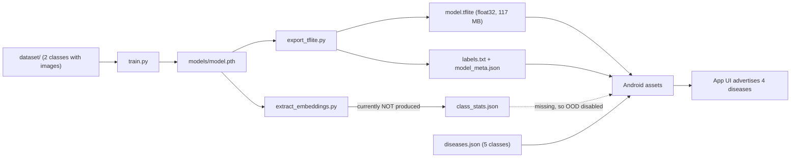

# PaddyCare AI: Full Code Review

**Scope:** every tracked source file. That covers the Python ML pipeline (7 files), the export pipeline, the Android app (21 Kotlin files plus resources and Gradle), configuration and docs. I also looked at the local `dataset/`, `models/` and `logs/` folders to compare the code with what is actually there.

**Severity legend**

| Tag | Meaning |
|---|---|
| 🔴 **P0** | Critical. Wrong results reach the user, or the shipped product is broken or misleading |
| 🟠 **P1** | High. A real bug, silent failure or reproducibility risk |
| 🟡 **P2** | Medium. Robustness, maintainability or performance |
| ⚪ **P3** | Low. Nits and polish |

---

## 1. Executive Summary

The **ML pipeline is well above average** for a project of this size:
- Training is two-phase with class-balanced sampling.
- Validation and test sets are forced onto the train class order.
- A checkpoint is only promoted to `model.pth` after a safety check.
- OOD statistics are statistically careful (Ledoit-Wolf shrinkage, calibrated on held-out data, verified on test).
- Preprocessing constants are exported to the app in `model_meta.json`.

Most serious problems are about **product correctness** and **how the artifacts fit together**, not the training code:

1. The model knows **2 classes**, but the app advertises and offers treatment for **4 diseases**. Leaves with Blast or Brown Spot will be forced into "Bacterial Blight" or "Healthy" and get the wrong treatment advice.
2. The UI shows **model confidence as disease "severity"**. A healthy leaf at 95% confidence gets a red **"মারাত্মক" (Severe)** badge.
3. **Mahalanobis OOD detection is currently disabled in the app**, because `class_stats.json` is not in the assets. The only "not a leaf" guard left is a permissive colour heuristic.
4. Nothing links `model.tflite`, `class_stats.json` and `model_meta.json` to one checkpoint. Stale files can silently mix.
5. **There is no parity check between PyTorch and TFLite, and no accuracy check of the TFLite model.** The model that ships has never been measured. The only stored test result (`logs/evaluate_results.json`) is from **8 images**.
6. Several screens are visual placeholders that look real to the user: fake experts, buttons that do nothing, settings that change nothing, stats hard-coded to "0".



---

## 2. 🔴 P0: Critical Issues

### P0-1. The app promises diseases the model cannot detect
- **Data:** `dataset/train` has 3200 images each for *Bacterial Blight* and *Healthy*. *Blast*, *Brown Spot* and *Not Leaf* have **0** images. [labels.txt](file:///d:/Model_final/paddy_ai/PaddyCareAndroid/app/src/main/assets/labels.txt) lists 2 classes.
- **UI:** [HomeScreen.kt:L463-L473](file:///d:/Model_final/paddy_ai/PaddyCareAndroid/app/src/main/java/com/paddycare/ai/ui/screens/HomeScreen.kt#L463-L473) shows Blast and Brown Spot as "common diseases". [HistoryScreen.kt:L303-L306](file:///d:/Model_final/paddy_ai/PaddyCareAndroid/app/src/main/java/com/paddycare/ai/ui/screens/HistoryScreen.kt#L303-L306) charts them.
- **Impact:** A binary softmax has no "neither" option. A Blast or Brown Spot leaf will most likely come out as Bacterial Blight, often with high confidence. The farmer is then told to spray **copper or streptomycin (for bacteria) on a fungal disease**. This is a real-world harm risk, not just cosmetic.
- **Fix:**
  - Build the disease cards and stats from `labels.txt` / `model_meta.json["classes"]`, not from hard-coded names.
  - Until the other classes are trained, add a clear note: *"This version detects only Bacterial Blight vs Healthy."*
  - Have an agronomist review the treatment text in [diseases.json](file:///d:/Model_final/paddy_ai/diseases.json), e.g. against BRRI guidance. Antibiotic use on crops is restricted in many regions.

### P0-2. Confidence is shown as "severity"
- [ResultScreen.kt:L142-L146](file:///d:/Model_final/paddy_ai/PaddyCareAndroid/app/src/main/java/com/paddycare/ai/ui/screens/ResultScreen.kt#L142-L146), [HistoryScreen.kt:L204-L213](file:///d:/Model_final/paddy_ai/PaddyCareAndroid/app/src/main/java/com/paddycare/ai/ui/screens/HistoryScreen.kt#L204-L213), [DiseaseCard.kt:L43-L47](file:///d:/Model_final/paddy_ai/PaddyCareAndroid/app/src/main/java/com/paddycare/ai/ui/components/DiseaseCard.kt#L43-L47)
  ```kotlin
  top.confidence >= 70f -> Triple(SeverityHigh, SeverityHighBg, "মারাত্মক")   // "Severe"
  ```
- Classifier confidence measures **how sure the model is about the label**. It says nothing about how badly the plant is infected.
- Results always have confidence ≥ 60% (see P1-11), so nearly every result is shown as "Severe". **That includes "Healthy" results.**
- **Fix:** Attach a static severity per disease, e.g. a `"severity": "high"` field in `diseases.json` (Healthy = none). Label confidence as "নিশ্চয়তা" (certainty) only.

### P0-3. OOD detection is effectively off in the shipped app
- [assets/](file:///d:/Model_final/paddy_ai/PaddyCareAndroid/app/src/main/assets) has no `class_stats.json`, and neither does `models/`. [PaddyClassifier.isOOD](file:///d:/Model_final/paddy_ai/PaddyCareAndroid/app/src/main/java/com/paddycare/ai/ml/PaddyClassifier.kt#L155-L160) therefore always returns `false`.
- The "Not Leaf" class has 0 training images, so the reject class never fires either.
- What is left is [ImagePreprocessor](file:///d:/Model_final/paddy_ai/PaddyCareAndroid/app/src/main/java/com/paddycare/ai/ml/ImagePreprocessor.kt#L53). It passes any image where **6% of pixels have a plant-like hue and 3% are green**: grass, a green shirt, a salad. Any such image then gets a disease prediction.
- **Fix:**
  - Run `python extract_embeddings.py` and confirm it passes its guards.
  - Make `export_tflite.py` **fail**, or at least print a loud warning, when stats are missing.
  - Collect real "Not Leaf" images. Other leaves, soil, hands and random objects are the cheapest strong OOD defence.

### P0-4. The shipped model has never been evaluated
- [evaluate.py](file:///d:/Model_final/paddy_ai/evaluate.py) only tests the **PyTorch** checkpoint. [export_tflite.py step 4](file:///d:/Model_final/paddy_ai/export_tflite.py#L164-L210) only feeds **random noise** to the TFLite model.
- `logs/evaluate_results.json` shows `support = 4 + 4`. A `--subset 4` run overwrote the real result. There is currently **no trustworthy recorded test metric**.
- Several things can silently change predictions: the onnx2tf NCHW→NHWC transposes, `--quantize`, and differences between Android and PIL resizing.
- **Fix:** Add a parity and accuracy step to the export:
  ```python
  # export_tflite.py, after conversion
  for img, label in test_subset:              # ~100 real images per class
      pt_logits = torch_model(val_transform(img)[None]).numpy()
      tfl_logits = run_tflite(np.transpose(x, (0, 2, 3, 1)))
      assert np.allclose(pt_logits, tfl_logits, atol=1e-3)   # relax for fp16/int8
  report_tflite_accuracy_and_f1()
  ```
  Also write evaluation results to a file named after the model and the subset, e.g. `evaluate_<timestamp>_<subset>.json`, so a smoke run can never replace the real report.

---

## 3. 🟠 P1: High Severity

### Python / ML pipeline

#### P1-1. `requirements.txt` allows torch versions the code cannot run on
- [requirements.txt:L2](file:///d:/Model_final/paddy_ai/requirements.txt#L2) says `torch>=2.0.0`. But [train.py:L194](file:///d:/Model_final/paddy_ai/train.py#L194) uses `torch.amp.GradScaler("cuda", ...)`, which only exists in **torch ≥ 2.3**. Before that it lived at `torch.cuda.amp.GradScaler`.
- **Fix:** Require `torch>=2.3` and `torchvision>=0.18`; the latter also makes `allow_empty` available natively. Better still, add a lock file such as `pip freeze > requirements-lock.txt`. The export dependencies (`onnx2tf`, `tensorflow`) are especially sensitive to versions.

#### P1-2. Model, stats and metadata can silently mismatch
- [copy_assets_to_android](file:///d:/Model_final/paddy_ai/export_tflite.py#L254-L276) copies `class_stats.json` whenever it exists. It never checks which checkpoint the file came from.
- Example: you train with `--no-stats`, or extraction fails before `remove_stale_stats()` runs. The **old stats then ship with the new model**. Mahalanobis distances against the wrong embedding space will reject almost every image, or almost none.
- **Fix:** Fingerprint the checkpoint, e.g. the SHA-256 of `model.pth` or the run timestamp. Write it into `model_meta.json`, `class_stats.json` and `labels.txt` (as a header) or a manifest. In the export script **and** in `PaddyClassifier`, turn OOD off with a warning if the fingerprints differ.

#### P1-3. Silent fallbacks to wrong class names
- [export_tflite.py:L65-L67](file:///d:/Model_final/paddy_ai/export_tflite.py#L65-L67) falls back to the hard-coded list `["Bacterial Blight", "Healthy"]`. [model.py:L57-L58](file:///d:/Model_final/paddy_ai/model.py#L57-L58) falls back to `NUM_CLASSES`, which [config.py:L75-L78](file:///d:/Model_final/paddy_ai/config.py#L75-L78) works out by **scanning whatever is in `dataset/train` right now**.
- A checkpoint without `class_names` can therefore be exported with labels in the wrong order or of the wrong size, and nothing complains.
- **Fix:** If `class_names` is missing from the checkpoint, raise an error. Every checkpoint `train.py` saves already includes it.

#### P1-4. Smoke and subset runs overwrite production artifacts in `logs/`
- [train.py:L288](file:///d:/Model_final/paddy_ai/train.py#L288) runs `save_training_curves(history, LOG_DIR)` *before* the `if smoke: return`. The current `logs/training_curves.png` comes from a 2-epoch, 4-image smoke run.
- `evaluate.py --subset` does the same to `evaluate_results.json` (see P0-4).
- **Fix:** Write per-run outputs only to `run_dir`. Update `logs/` only when the model is promoted.

#### P1-5. Checkpoint promotion compares F1 scores from different validation sets
- [should_promote_checkpoint](file:///d:/Model_final/paddy_ai/train.py#L131-L163) compares the new `val_macro_f1` with the old one. But `--subset N` without `--smoke` scores the new model on a **subset** of val, and the old model may have been scored on the full set or a different version of the dataset.
- In addition, changing the class list means automatic promotion even if the new model is much worse.
- **Fix:** Store `val_set_hash` and `subset` in the checkpoint and only compare like with like. Refuse to promote any `--subset` run unless `--force` is passed.

#### P1-6. BatchNorm updates with physical batch size 8 during fine-tuning
- In Phase 2 ([train.py:L232](file:///d:/Model_final/paddy_ai/train.py#L232)) the whole network goes into `train()` mode. All EfficientNet-B5 BN layers then update their running statistics from **8 images**. Gradient accumulation does not help BN.
- This is a common cause of a val/test gap and of embedding drift, which also hurts Mahalanobis OOD.
- **Fix:** Keep BN frozen during fine-tuning:
  ```python
  def freeze_bn(m):
      for mod in m.modules():
          if isinstance(mod, nn.BatchNorm2d):
              mod.eval()
              for p in mod.parameters(): p.requires_grad = False
  ```
  Call it after `model.train()` in Phase 2 as well. Alternatively, use a larger physical batch at a lower resolution.

#### P1-7. Possible train/val/test leakage (please verify)
- Each split has *exactly* 3200 / 400 / 400 images per class. That pattern is typical of public paddy datasets that were augmented (rotations, flips, crops) **before** splitting. Near-duplicates across splits make val and test scores look better than they are.
- **Fix:** Run a perceptual-hash check (`imagehash.phash`) across the splits and remove any matches. If the source has field or plot IDs, split by those groups.

#### P1-8. EXIF orientation is ignored in training
- torchvision's default `pil_loader` does **not** apply EXIF rotation. Android's `ImageDecoder` **does**. Phone photos in the dataset can be loaded sideways during training but upright on the device.
- [dataset_utils.py:L10](file:///d:/Model_final/paddy_ai/dataset_utils.py#L10) also sets `ImageFile.LOAD_TRUNCATED_IMAGES = True` for the whole process, so corrupt files are trained on silently.
- **Fix:**
  ```python
  def exif_loader(path):
      with Image.open(path) as im:
          return ImageOps.exif_transpose(im).convert("RGB")
  # SafeImageFolder(..., loader=exif_loader)
  ```
  Add a one-off `verify_dataset.py` that lists unreadable or truncated files instead of hiding them.

### Android ML

#### P1-9. Mismatches between labels and model only produce a warning
- [PaddyClassifier.kt:L81-L94](file:///d:/Model_final/paddy_ai/PaddyCareAndroid/app/src/main/java/com/paddycare/ai/ml/PaddyClassifier.kt#L81-L94) only logs a warning. [L143](file:///d:/Model_final/paddy_ai/PaddyCareAndroid/app/src/main/java/com/paddycare/ai/ml/PaddyClassifier.kt#L143) then pairs up `min(labels, logits)` entries, so predictions come out with the wrong names.
- **Fix:** Throw from `init` when the counts differ, and show an error screen. This is a packaging bug and should never reach users.

#### P1-10. Outputs are told apart by tensor shape
- Both [PaddyClassifier.kt:L115-L125](file:///d:/Model_final/paddy_ai/PaddyCareAndroid/app/src/main/java/com/paddycare/ai/ml/PaddyClassifier.kt#L115-L125) and [export_tflite.py:L194-L199](file:///d:/Model_final/paddy_ai/export_tflite.py#L194-L199) decide which output holds the logits by checking `shape[1] != 128`. This breaks if the class count is ever 128, and it is fragile in general.
- **Fix:** Find outputs by tensor name (`getOutputTensor(i).name()` contains `logits` or `embedding`). The ONNX names carry through onnx2tf. Otherwise, write the output indices into `model_meta.json`.

#### P1-11. The confidence threshold does nothing for 2 classes
- The entropy threshold is `0.75 × ln 2 ≈ 0.520` nats. In a binary softmax that equals a top probability of about **0.785**. The entropy check is therefore always stricter than `confidence_threshold = 0.60` ([HomeScreen.kt:L144](file:///d:/Model_final/paddy_ai/PaddyCareAndroid/app/src/main/java/com/paddycare/ai/ui/screens/HomeScreen.kt#L144)), so the 0.60 setting never matters.
- This is not a bug, but the thresholds are not tuned on data. **Fix:** Calibrate both thresholds on val, for example with temperature scaling followed by a target coverage or precision. Export the calibrated values, as is already done for the Mahalanobis threshold.

#### P1-12. Interpreter is not thread-safe, and a classifier can leak
- [HomeScreen.kt:L111](file:///d:/Model_final/paddy_ai/PaddyCareAndroid/app/src/main/java/com/paddycare/ai/ui/screens/HomeScreen.kt#L111): `app?.classifier ?: PaddyClassifier(context)`. If the fallback ever runs, it maps another 117 MB model on every scan and never closes it.
- `Interpreter.run` is not thread-safe. If the user leaves the screen mid-inference (the compose scope is cancelled but `run` keeps going) and then taps Analyze on a new HomeScreen, two calls can overlap.
- **Fix:** Drop the fallback. Guard `classify` with a `Mutex` / `synchronized`, or move inference into a singleton repository that has a single-threaded dispatcher.

### Android app

#### P1-13. Result is lost on rotation or process death
- [AppNavigation.kt:L60-L61](file:///d:/Model_final/paddy_ai/PaddyCareAndroid/app/src/main/java/com/paddycare/ai/navigation/AppNavigation.kt#L60-L61) keeps `currentResult` in plain `remember`. After a rotation the Result route renders **nothing** ([L247](file:///d:/Model_final/paddy_ai/PaddyCareAndroid/app/src/main/java/com/paddycare/ai/navigation/AppNavigation.kt#L247)), leaving a blank screen.
- **Fix:** Store the result in a `ViewModel` with `SavedStateHandle`. Or navigate to `result/{scanId}` and load the record from Room. The record is already saved to the database.

#### P1-14. Placeholder features that look real
| Location | Problem |
|---|---|
| [ExpertsScreen.kt:L31-L37](file:///d:/Model_final/paddy_ai/PaddyCareAndroid/app/src/main/java/com/paddycare/ai/ui/screens/ExpertsScreen.kt#L31-L37) | Made-up named experts at real institutions (BARI, BAU), and the call and chat buttons are `onClick = {}` |
| [SettingsScreen.kt:L195](file:///d:/Model_final/paddy_ai/PaddyCareAndroid/app/src/main/java/com/paddycare/ai/ui/screens/SettingsScreen.kt#L195) | Language, Clear history and Backup rows do nothing |
| [SettingsScreen.kt:L79-L81](file:///d:/Model_final/paddy_ai/PaddyCareAndroid/app/src/main/java/com/paddycare/ai/ui/screens/SettingsScreen.kt#L79-L81) | Push and email toggles save a value that nothing reads |
| [SettingsScreen.kt:L110](file:///d:/Model_final/paddy_ai/PaddyCareAndroid/app/src/main/java/com/paddycare/ai/ui/screens/SettingsScreen.kt#L110) | Says "সংস্করণ ২.০.১" (v2.0.1), but `versionName = "1.0.0"` |
| [HomeScreen.kt:L269-L271](file:///d:/Model_final/paddy_ai/PaddyCareAndroid/app/src/main/java/com/paddycare/ai/ui/screens/HomeScreen.kt#L269-L271) | Scan, disease and healthy stats are hard-coded to `"0"` |
| [ResultScreen.kt:L65](file:///d:/Model_final/paddy_ai/PaddyCareAndroid/app/src/main/java/com/paddycare/ai/ui/screens/ResultScreen.kt#L65) | Share button does nothing |

Showing invented people at real institutions is a **Play Store policy (deceptive behaviour) and reputation risk**. Remove these features or hide them behind a "Coming soon" state.

#### P1-15. `targetSdk = 34` will be rejected by Google Play
- [build.gradle.kts:L10-L15](file:///d:/Model_final/paddy_ai/PaddyCareAndroid/app/build.gradle.kts#L10-L15). Play now requires recent target API levels (35 or higher for new apps, and the bar rises every August). Raise `compileSdk` and `targetSdk` together, then re-test edge-to-edge behaviour; `window.statusBarColor` in [Theme.kt:L125](file:///d:/Model_final/paddy_ai/PaddyCareAndroid/app/src/main/java/com/paddycare/ai/ui/theme/Theme.kt#L125) is deprecated from API 35.

---

## 4. 🟡 P2: Medium Severity

### Python

| # | Location | Issue | Suggestion |
|---|---|---|---|
| P2-1 | [config.py:L26](file:///d:/Model_final/paddy_ai/config.py#L26) | `WARMUP_EPOCHS = 10` of 20 means half the training has a frozen backbone | 2–3 warm-up epochs is usually enough for the head to converge |
| P2-2 | [train.py:L233-L236](file:///d:/Model_final/paddy_ai/train.py#L233-L236) | Phase-2 learning rates `1e-5` / `1e-4` are hard-coded and ignore `config.LEARNING_RATE`; the log message hard-codes them too | Move them to `config.py` (`BACKBONE_LR`, `HEAD_LR`) |
| P2-3 | [train.py:L186-L190](file:///d:/Model_final/paddy_ai/train.py#L186-L190) | Weight decay also applies to biases and BN parameters | Use two param groups: `decay` and `no_decay` |
| P2-4 | [train.py:L27-L35](file:///d:/Model_final/paddy_ai/train.py#L27-L35) | Seeds and device are set at **import time**; DataLoader workers aren't seeded, and there's no `torch.Generator` for the sampler | Add a `set_seed()` called from `main`; pass `generator=` and `worker_init_fn` |
| P2-5 | [train.py:L263-L275](file:///d:/Model_final/paddy_ai/train.py#L263-L275) | Checkpoint stores `optimizer_state_dict`, which roughly triples the file size in Phase 2 and isn't used for resuming | Save optimizer state only to a separate `last.pth` for resume; keep `model.pth` small |
| P2-6 | [train.py](file:///d:/Model_final/paddy_ai/train.py) | No early stopping and no `--resume` | Add a patience setting on val F1 and resume from `last.pth` |
| P2-7 | [dataset_utils.py:L34](file:///d:/Model_final/paddy_ai/dataset_utils.py#L34) | `TrivialAugmentWide` can solarize, posterize and equalize; colour is a key cue (yellow-brown streaks vs brown spots) | Use a custom RandAugment without solarize/posterize, or lower its strength; check with an ablation |
| P2-8 | [model.py:L76-L90](file:///d:/Model_final/paddy_ai/model.py#L76-L90) | The embedding layer is located by index (`classifier[5]`, `classifier[:6]`, `classifier.7.weight`) in three files; the hook isn't removed if `forward` raises | Give the head named submodules (`self.embed`, `self.head`) and a `forward_with_embedding()`; use `try/finally` for hooks |
| P2-9 | [config.py:L57-L72](file:///d:/Model_final/paddy_ai/config.py#L57-L72) and [dataset_utils.py:L65-L79](file:///d:/Model_final/paddy_ai/dataset_utils.py#L65-L79) | Class-discovery logic is duplicated; config scans the disk **on import** | One helper function; compute class names lazily |
| P2-10 | [dataset_utils.py:L60-L63](file:///d:/Model_final/paddy_ai/dataset_utils.py#L60-L63) | `except TypeError` also swallows unrelated TypeErrors raised inside `ImageFolder.__init__` | Check `inspect.signature(ImageFolder.__init__)` for `allow_empty` instead |
| P2-11 | [export_tflite.py:L292-L299](file:///d:/Model_final/paddy_ai/export_tflite.py#L292-L299) | `model_meta.json` is written **before** conversion; if conversion fails, the metadata and the model disagree | Write the metadata and labels only after step 4 passes; stage files in a temporary folder and move them into place together |
| P2-12 | [export_tflite.py:L147-L161](file:///d:/Model_final/paddy_ai/export_tflite.py#L147-L161) | Only `ImportError` is caught; the "int8" label is really dynamic-range quantization | onnx2tf already writes `model_float16.tflite` (about 59 MB, close to lossless). Offer `--precision {fp32,fp16,dr}` and validate whichever is chosen |
| P2-13 | [export_tflite.py:L164-L187](file:///d:/Model_final/paddy_ai/export_tflite.py#L164-L187) | Doesn't assert that the input is NHWC `[1,456,456,3]` float32, which `PaddyClassifier` assumes | Add `assert tuple(input_shape) == (1, IMAGE_SIZE, IMAGE_SIZE, 3)` |
| P2-14 | [export_tflite.py:L41](file:///d:/Model_final/paddy_ai/export_tflite.py#L41) | No `--model` argument (always `models/model.pth`), unlike the other scripts | Add `--model` for consistency |
| P2-15 | [extract_embeddings.py:L95-L104](file:///d:/Model_final/paddy_ai/extract_embeddings.py#L95-L104) | Python loop over samples | Vectorise: `np.einsum('ij,jk,ik->i', d, P, d)` |
| P2-16 | [evaluate.py:L110-L116](file:///d:/Model_final/paddy_ai/evaluate.py#L110-L116) | Results don't record which checkpoint, epoch or subset produced them | Add `model_path`, `epoch`, `timestamp`, `subset` and a checkpoint hash |
| P2-17 | Repository | **No tests at all** | Add pytest checks: `PadToSquare` shapes, the `DualOutputWrapper` vs `model` logits match, `should_promote_checkpoint` cases, the `_distances` maths, and a TFLite parity test on 4 images |

### Android

| # | Location | Issue | Suggestion |
|---|---|---|---|
| P2-18 | [PaddyClassifier.kt:L303-L304](file:///d:/Model_final/paddy_ai/PaddyCareAndroid/app/src/main/java/com/paddycare/ai/ml/PaddyClassifier.kt#L303-L304) | `(maxSide - w) / 2f` can land on half a pixel, so the edge gets blended; Python uses `int(...)` | Use integer offsets: `((maxSide - w) / 2).toFloat()` |
| P2-19 | [PaddyClassifier.kt:L104](file:///d:/Model_final/paddy_ai/PaddyCareAndroid/app/src/main/java/com/paddycare/ai/ml/PaddyClassifier.kt#L104) | `createScaledBitmap(filter=true)` is plain bilinear, while PIL `Resize` is anti-aliased bilinear; scaling 1024→456 aliases visibly on fine leaf texture | Downscale in steps of at most 2× each, or decode straight to about 456 px; confirm with the parity test from P0-4 |
| P2-20 | [PaddyClassifier.kt:L240-L254](file:///d:/Model_final/paddy_ai/PaddyCareAndroid/app/src/main/java/com/paddycare/ai/ml/PaddyClassifier.kt#L240-L254) | Mahalanobis maths runs in `Float`; the precision matrix can be badly conditioned (the old log showed cond ≈ 8×10⁵) | Store it as `DoubleArray` and add up in `Double`; it's only 16k multiply-adds |
| P2-21 | [PaddyClassifier.kt:L227-L232](file:///d:/Model_final/paddy_ai/PaddyCareAndroid/app/src/main/java/com/paddycare/ai/ml/PaddyClassifier.kt#L227-L232) | Never checks `embedding_dim` in the stats file against `EMBEDDING_DIM`, or that each class mean has length 128 | Validate after loading; if anything doesn't match, turn OOD off and log it |
| P2-22 | [PaddyClassifier.kt:L262](file:///d:/Model_final/paddy_ai/PaddyCareAndroid/app/src/main/java/com/paddycare/ai/ml/PaddyClassifier.kt#L262) | Allocates a 2.5 MB direct buffer and a 208K `IntArray` on every call | Allocate once and reuse |
| P2-23 | [PaddyClassifier.kt:L73-L76](file:///d:/Model_final/paddy_ai/PaddyCareAndroid/app/src/main/java/com/paddycare/ai/ml/PaddyClassifier.kt#L73-L76) | EfficientNet-B5 at 456² is about 10 GFLOPs; a mid-range CPU takes seconds; the 117 MB model makes a 133 MB APK | For 2 classes, B0–B2 or MobileNetV3 at 224–288 is probably enough; at the very least ship fp16 and try the GPU delegate / NNAPI |
| P2-24 | [ImagePreprocessor.kt:L42-L46](file:///d:/Model_final/paddy_ai/PaddyCareAndroid/app/src/main/java/com/paddycare/ai/ml/ImagePreprocessor.kt#L42-L46) | Comment says hue "28°–210°" but the code uses 14°–106°; it refers to a Python `check_paddy_image()` that no longer exists; `r`, `g`, `b` are unused | Fix the comment; move the thresholds into `model_meta.json`; tune them on a labelled leaf / non-leaf set |
| P2-25 | [HomeScreen.kt:L103-L179](file:///d:/Model_final/paddy_ai/PaddyCareAndroid/app/src/main/java/com/paddycare/ai/ui/screens/HomeScreen.kt#L103-L179), [AppNavigation.kt:L207-L239](file:///d:/Model_final/paddy_ai/PaddyCareAndroid/app/src/main/java/com/paddycare/ai/navigation/AppNavigation.kt#L207-L239) | Inference, decision rules, file I/O and DB pruning all sit inside composables | Move them into `ScanViewModel` → `ScanRepository` (classifier + DAO), which can then be unit-tested |
| P2-26 | [HistoryScreen.kt:L41](file:///d:/Model_final/paddy_ai/PaddyCareAndroid/app/src/main/java/com/paddycare/ai/ui/screens/HistoryScreen.kt#L41) | `getAllScans()` returns a **new Flow on every recomposition**, so `collectAsState` keeps re-subscribing | `val flow = remember { dao.getAllScans() }`, or collect in a ViewModel |
| P2-27 | [HomeScreen.kt:L112](file:///d:/Model_final/paddy_ai/PaddyCareAndroid/app/src/main/java/com/paddycare/ai/ui/screens/HomeScreen.kt#L112), [L117](file:///d:/Model_final/paddy_ai/PaddyCareAndroid/app/src/main/java/com/paddycare/ai/ui/screens/HomeScreen.kt#L117), [L136-L140](file:///d:/Model_final/paddy_ai/PaddyCareAndroid/app/src/main/java/com/paddycare/ai/ui/screens/HomeScreen.kt#L136-L140) | Language is mixed: treatments follow the app setting, `getString()` follows the system locale, and the OOD message is hard-coded; most UI text is Bengali typed into the code, and much of `strings.xml` is unused | Put all text in `strings.xml` + `values-en/strings.xml`; set the app language with `AppCompatDelegate.setApplicationLocales` |
| P2-28 | [HomeScreen.kt:L79-L84](file:///d:/Model_final/paddy_ai/PaddyCareAndroid/app/src/main/java/com/paddycare/ai/ui/screens/HomeScreen.kt#L79-L84) | Temporary camera files in `cacheDir/camera_photos` are never deleted | Delete each one after `saveScanBitmap`, or clear the folder at app start |
| P2-29 | [HomeScreen.kt:L92-L94](file:///d:/Model_final/paddy_ai/PaddyCareAndroid/app/src/main/java/com/paddycare/ai/ui/screens/HomeScreen.kt#L92-L94) | Denying camera permission gives no feedback (the `permission_needed` strings are never used) | Show a snackbar or rationale with a link to Settings |
| P2-30 | [HomeScreen.kt:L168](file:///d:/Model_final/paddy_ai/PaddyCareAndroid/app/src/main/java/com/paddycare/ai/ui/screens/HomeScreen.kt#L168) | On error, the history saves the gallery `content://` URI, which can lose permission later | Always save a copy under `filesDir/scans` |
| P2-31 | [build.gradle.kts:L34-L38](file:///d:/Model_final/paddy_ai/PaddyCareAndroid/app/build.gradle.kts#L34-L38) | Lint is turned off (`abortOnError=false`, `checkReleaseBuilds=false`) to work around a JDK 25 crash | Build with JDK 17 (AGP's supported toolchain) and turn lint back on |
| P2-32 | [build.gradle.kts:L69](file:///d:/Model_final/paddy_ai/PaddyCareAndroid/app/build.gradle.kts#L69), [L86](file:///d:/Model_final/paddy_ai/PaddyCareAndroid/app/build.gradle.kts#L86), [L97](file:///d:/Model_final/paddy_ai/PaddyCareAndroid/app/build.gradle.kts#L97) | `lifecycle-viewmodel-compose`, `tensorflow-lite-support` and `accompanist-permissions` are **never used** | Remove them (or start using ViewModel, see P2-25) |
| P2-33 | [AppDatabase.kt:L8](file:///d:/Model_final/paddy_ai/PaddyCareAndroid/app/src/main/java/com/paddycare/ai/data/AppDatabase.kt#L8) | `exportSchema = false` and no migrations, so the first schema change will crash existing installs | Export the schema and add `Migration`s, or use `fallbackToDestructiveMigration()` on purpose |

---

## 5. ⚪ P3: Low Severity / Nits

**Python**
- [log_utils.py:L36-L42](file:///d:/Model_final/paddy_ai/log_utils.py#L36-L42): `attach_file_log` is never used.
- [log_utils.py:L5-L10](file:///d:/Model_final/paddy_ai/log_utils.py#L5-L10) and [export_tflite.py:L19-L24](file:///d:/Model_final/paddy_ai/export_tflite.py#L19-L24): `sys.stdout.reconfigure` is duplicated and runs on import.
- `logs/train.log` is append-only and has no rotation. It still contains old Flask server output; use `RotatingFileHandler`.
- [dataset_utils.py:L122](file:///d:/Model_final/paddy_ai/dataset_utils.py#L122): `set(val_dataset.targets)` is rebuilt on every loop iteration. Build it once.
- [dataset_utils.py:L149-L151](file:///d:/Model_final/paddy_ai/dataset_utils.py#L149-L151): `print` and `logging` are both used for the same messages.
- [evaluate.py:L71-L76](file:///d:/Model_final/paddy_ai/evaluate.py#L71-L76): `pin_memory` is missing, and there's no `torch.inference_mode()` or AMP (unlike `validate`).
- [model.py:L24](file:///d:/Model_final/paddy_ai/model.py#L24): trailing whitespace. `from config import NUM_CLASSES` means importing the model scans the disk.
- Label smoothing (0.1) is known to tighten penultimate-layer clusters and can weaken feature-based OOD detection (Müller et al., 2019). It's worth comparing with and without it once OOD stats exist.
- Type hints use `tuple[...]` / `list` (Python 3.9+). State `python_requires` in the README.

**Android**
- [MainActivity.kt:L18](file:///d:/Model_final/paddy_ai/PaddyCareAndroid/app/src/main/java/com/paddycare/ai/MainActivity.kt#L18): the `initial = isSystemInDarkTheme()` argument is ignored because `darkMode` is a `StateFlow`, so the app never follows the system theme. Use a tri-state setting (system / light / dark).
- [DiseaseCard.kt](file:///d:/Model_final/paddy_ai/PaddyCareAndroid/app/src/main/java/com/paddycare/ai/ui/components/DiseaseCard.kt) is **unused** dead code that uses colours with no dark-mode variant. Delete it.
- [DiseaseInfo.kt:L22-L103](file:///d:/Model_final/paddy_ai/PaddyCareAndroid/app/src/main/java/com/paddycare/ai/data/DiseaseInfo.kt#L22-L103) hard-codes a copy of `diseases.json`, which will drift. The JSON already ships in the assets, so keep just the one source.
- [HistoryScreen.kt:L201](file:///d:/Model_final/paddy_ai/PaddyCareAndroid/app/src/main/java/com/paddycare/ai/ui/screens/HistoryScreen.kt#L201): a new `SimpleDateFormat` is created for every item on every recomposition. `remember` it.
- Hard-coded top padding (`48.dp`, `52.dp`) instead of `WindowInsets.statusBars` breaks on devices with a notch or cutout.
- [AppNavigation.kt:L114-L118](file:///d:/Model_final/paddy_ai/PaddyCareAndroid/app/src/main/java/com/paddycare/ai/navigation/AppNavigation.kt#L114-L118): `.shadow()` comes after `.background()`, so the FAB shadow is clipped. Swap the order.
- [file_paths.xml](file:///d:/Model_final/paddy_ai/PaddyCareAndroid/app/src/main/res/xml/file_paths.xml): `scan_images` is never used through FileProvider.
- [PaddyClassifier.kt:L309-L318](file:///d:/Model_final/paddy_ai/PaddyCareAndroid/app/src/main/java/com/paddycare/ai/ml/PaddyClassifier.kt#L309-L318): `AssetFileDescriptor` and `FileInputStream` are never closed. The mapping stays valid after closing them.
- Use `androidx.exifinterface` instead of the framework `android.media.ExifInterface`.
- `android:allowBackup="true"` without `dataExtractionRules` means scan photos go into cloud backups. Decide this on purpose.
- Images have no `contentDescription` and emoji are used as icons, which hurts accessibility for TalkBack users.

**Repo**
- `PaddyCare_AI_Progression.pptx` (2.5 MB binary) is tracked in git. Move it to releases or LFS.
- `model.tflite` is gitignored (fine), but a fresh clone cannot build a working app. Say in the README that `export_tflite.py` must run first, or have the app check for the asset at startup.
- The README says "int8 quantization". It's actually dynamic-range quantization (int8 weights, float activations).

---

## 6. What's Done Well ✅

- **Train class order is forced onto val and test** in [SafeImageFolder](file:///d:/Model_final/paddy_ai/dataset_utils.py#L48-L79). This prevents a very common label-index bug.
- **The checkpoint is the source of truth for class names** (`model.class_names`), and evaluate and extract both use it.
- **Promotion safety:** each run gets its own folder, the previous model is backed up with a timestamp, and promotion depends on F1.
- **The OOD maths is careful:** Ledoit-Wolf shrinkage, a minimum-sample guard (`8 × dim`), the threshold calibrated on **held-out val** using distance to the *predicted* class (exactly what the app does), verification on test, and stale-stats removal when something fails.
- **Macro-F1** is used for model selection, not accuracy.
- **Preprocessing parity is designed in:** `PadToSquare` exists on both sides, and mean, std and size are exported to `model_meta.json`.
- **Dual-output export** (logits + embedding) means one inference pass covers both classification and OOD.
- On Android: the model is memory-mapped once in `Application`, the model file is stored uncompressed (`noCompress "tflite"`), EXIF is handled before API 28, decoding is capped at 1024 px, and history is pruned together with its image files.
- `setup_logging` is called from `main` and never at import, and the docstring explains why.

---

## 7. Recommended Action Plan

| Order | Action | Fixes |
|---|---|---|
| 1 | Make the app show only the classes in `labels.txt`, and add a "detects only X / Y" notice | P0-1 |
| 2 | Replace confidence-as-severity with a severity field per disease | P0-2 |
| 3 | Generate and ship `class_stats.json`; make export fail without it; collect "Not Leaf" data | P0-3 |
| 4 | Add a PyTorch↔TFLite parity and accuracy step; stop subset runs from overwriting reports | P0-4, P1-4 |
| 5 | Fingerprint the checkpoint across all exported artifacts and verify it in the app | P1-2, P1-3 |
| 6 | Pin dependencies (torch ≥ 2.3), freeze BN in Phase 2, load images with EXIF rotation, check for duplicates across splits | P1-1, P1-6, P1-7, P1-8 |
| 7 | Remove or hide placeholder screens; raise targetSdk; turn lint back on with JDK 17 | P1-14, P1-15, P2-31 |
| 8 | Add a ViewModel and repository layer; fix state saving, thread safety and the Flow re-subscription | P1-12, P1-13, P2-25, P2-26 |
| 9 | Ship fp16 (or a smaller backbone) to cut size and latency | P2-12, P2-23 |
| 10 | Add a minimal pytest suite and a GitHub Actions workflow | P2-17 |
